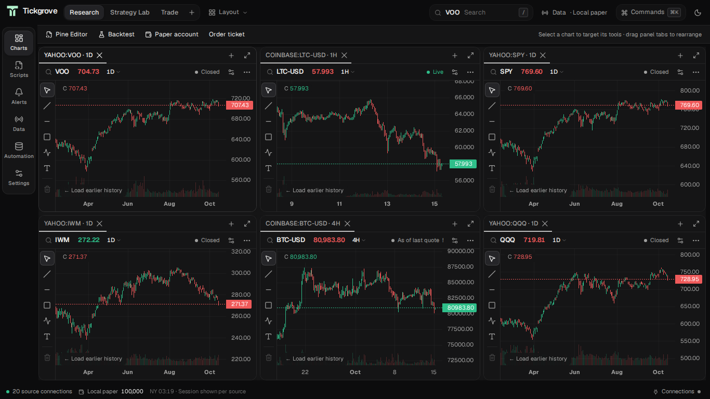

<picture>
  <source media="(prefers-color-scheme: dark)" srcset="public/brand/tickgrove-lockup-dark.svg">
  
</picture>

A self-hosted trading workspace built with Rust and React.

[Quick start](#quick-start) · [Self-hosting](docs/self-hosting.md) · [Data sources](docs/free-data.md) · [API & MCP](docs/api.md)



- **Charts** — linked layouts, watchlists, drawing tools, indicators and alerts.
- **Strategies** — Pine scripts, local libraries, visual strategies and Composer-style portfolios.
- **Backtesting** — saved strategy versions, reproducible data snapshots, equity curves and trade history.
- **Paper trading** — local simulated accounts and continuous strategy sessions.
- **Extensions** — HTTP API, CLI, MCP and process plugins.

## Quick start

Requires Linux, Docker Compose and unprivileged user namespaces. [Ubuntu setup](docs/self-hosting.md#ubuntu-sandbox-setup).

```sh
git clone https://github.com/hadan8977/tickgrove.git
cd tickgrove
docker compose up --build -d
docker compose exec trading cat /app/var/auth-token
```

Open [localhost:8787](http://localhost:8787) and enter the token. SQLite and application state persist in the Docker volume.

Choose a symbol in **Charts**, or open **Scripts → Import Pine**. Add your own provider account in **Settings → Connections**.

## Data

Stock and ETF history uses Yahoo's public interface. Crypto history and live updates use Coinbase. Both work without a data key. Connect your own Alpaca account for its supported stock feeds and Paper broker access.

Coverage, delay and feed permissions depend on the source.

## Contributing

Issues and pull requests are welcome. Include a script, symbol, interval and data source when reporting strategy or market-data bugs. See the [development guide](docs/self-hosting.md#development).

## License

[Licenses and third-party notices](docs/licenses.md).
