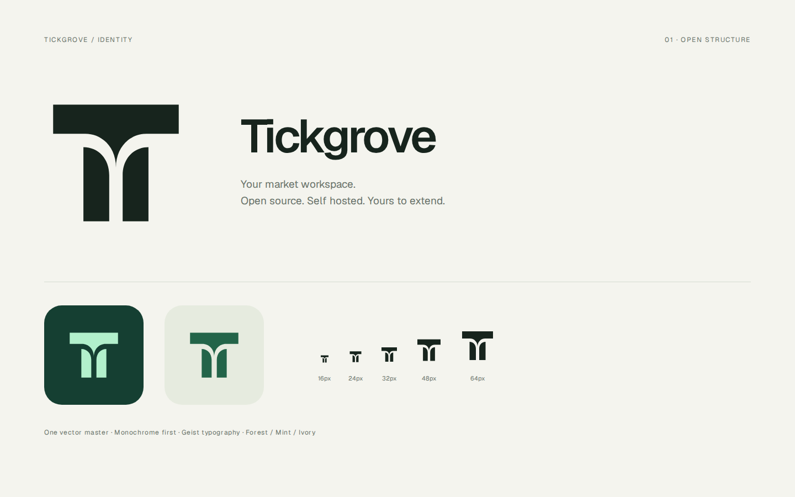

# Tickgrove identity

**Tickgrove** — An extensible trading workspace.

The mark is a modular **T** with a branching open counter. A broad cap and two curved stems create one readable silhouette: a stable workspace with room to extend. Solid geometry, generous negative space and monochrome reproduction come first.



## Assets

- [Forest mark](../public/brand/tickgrove-mark.svg)
- [Monochrome mark](../public/brand/tickgrove-mark-mono.svg)
- [Inverse mark](../public/brand/tickgrove-mark-inverse.svg)
- [App icon](../public/brand/tickgrove-icon.svg)
- [Avatar PNG](../public/brand/tickgrove-avatar.png)
- [Social preview PNG](../public/brand/tickgrove-social.png)
- [Light lockup](../public/brand/tickgrove-lockup-light.svg)
- [Dark lockup](../public/brand/tickgrove-lockup-dark.svg)
- [Outlined wordmark](../public/brand/tickgrove-wordmark.svg)

Standalone colors are forest `#236449`, deep forest `#153F32`, and mint `#B2F0CC`. In the application, the mark uses the light/dark brand token while text follows the active theme. Keep at least one-quarter of the mark's width clear around standalone artwork. The mark is intended to remain legible at 16 px; use the full wordmark when space permits.

The React mark and exported SVGs share [mark.json](../src/brand/mark.json). Run `npm run brand:generate` after editing it. The standalone wordmark contains outlined Geist SemiBold glyphs, so exported SVGs do not depend on an installed font. Its geometry and source are recorded in [wordmark.json](../src/brand/wordmark.json); the font's [OFL license](../public/fonts/geist-OFL.txt) is retained. The application uses the bundled Geist font for live text.

Product name: `Tickgrove`. Repository and executable prefix: `tickgrove`. Use ordinary capitalization in prose and lowercase in technical identifiers. The name identifies the workspace across markets, data providers, and strategy runtimes.

Historical reports and upstream attributions keep their original names. Legacy protocol IDs, storage formats, and command aliases are compatibility contracts; they are not new product names. See the [upgrade notes](self-hosting.md#upgrading-from-trading-dashboard).

## Design process

The October 2026 redesign used the built-in image generation tool with the `imagegen` skill to explore three distinct directions. The selected middle direction was then rebuilt as original SVG geometry, adjusted for small sizes, and integrated into the application. Lovart was not available in this environment. The raster exploration is a design reference; the shipped logo is a deterministic vector master.

- [Exploration board](design/logo-exploration.png)
- [Exact generation prompt](design/logo-prompt.txt)
- [Vector master](../src/brand/mark.json)

`npm run brand:generate` updates SVG exports, including the social card. To render the avatar, social PNG and identity board with an optional local Playwright installation:

```sh
PLAYWRIGHT_MODULE=/path/to/playwright BROWSER_EXECUTABLE=/path/to/chromium node scripts/render-brand.cjs
```

The generation scripts retain a single geometry source across the live React logo, favicon, standalone exports and social artwork. The small-size sheet tests 16, 24, 32, 48 and 64 px. Symbol design and visual distinction are not a trademark clearance opinion.
