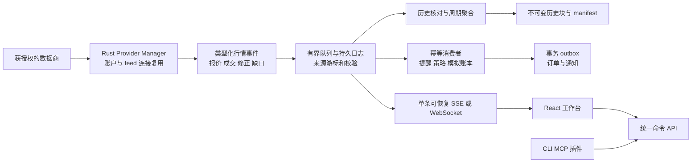

# Tickgrove 正式版本审查与升级方案

2026-10-15 · 审阅版本 `ec039649fe9f4b8729b977e819509910bf95cc2a`

**结论：继续打磨受控 Alpha，先修执行正确性、正式行情合同和核心操作路径，再做公开推广。** Rust + React、自托管、Pine、可扩展接口的方向可以保留。当前有可用功能，但仍有已复现缺陷，不能把一次闭环演示作为正式版本验收。

本轮完成三个独立子 agent 的取证审查、主 agent 交叉复核、定向复现和推广规划；没有修改生产实现或发布社媒内容。用户要求先比较数据方案，尚未选定商业模式；**BYOK 是候选建议，不是已确认决定**。免费体验、个人正式数据和项目采购共享行情分别评估，公开演示单独选择可展示的数据。原先的 96 项需求全部保留，没有通过删需求来宣称完成。

相关交付：[数据方案比较](data-options.md) · [执行 backlog](backlog.json) · [推广方案与文案草稿](launch-plan.md) · [复现说明](evidence/README.md)

## 审查覆盖与证据

借用 [pstack swarm](https://github.com/cursor/plugins/blob/main/pstack/skills/swarm/SKILL.md) 的分工、独立取证、聚合报告方法。最初读取 backnotprop 分支，随后核对 poteto 的原版；没有安装全局插件或调用 Grok/Claude。三个子 agent 使用当前环境可用的同一模型，并非跨模型验证。Open Composer 的 `backtest-forensics` 与 `execution-reality-reviewer` 只提供方法参考：核对输入、来源、成交与账本；没有对某个策略生成收益评价或统计合格证明。

| 审查 | 方法 | 结论 | 边界 |
|---|---|---|---|
| 正式行情 | Rust/React 源码、历史验收、数据商官方合同 | ISSUES | 无正式账户权限测试，无压测 |
| 产品易用性 | 当前源码、既有截图、TradingView 官方界面；追加浏览器定向复现 | ISSUES | 网格状态丢失已新复现；其余交互发现以源码为主；无真人测试成绩 |
| 执行与发布 | Pine 实际运行、隔离 Rust 实例、持久化/恢复路径、发布证据 | ISSUES | 两个运行时问题及实时提醒缺失有实证；崩溃窗口尚待故障注入 |
| 汇总与推广 | 交叉读代码、重跑发布门禁、官方项目/平台规则 | 尚未达到推广条件 | 宣传内容是待验收版本的草稿，未发送 |

`node scripts/check-release.cjs` 本轮返回失败：96 项中 6 项 `verified`、87 项 `partial`、1 项 `planned`、2 项 `blocked_external`。**这不是“只有六个功能能用”，而是完整需求的验收证据还没有闭合。** 现有门禁仅检查文件存在，后续还应验证报告结果、版本、执行器 hash 和镜像身份。

原始审查：[数据](data-review.txt)、[易用性](usability-review.txt)、[执行与发布](reliability-review.txt)。原始审查的 P0 表示对应宣传承诺的阻断；本汇总统一区分“急需修复的 P1 缺陷”和“发布条件”，不把所有缺口称为系统级 P0。

## 首先修复的具体问题

| 编号 | 发现与影响 | 证据 | 修复与完成条件 |
|---|---|---|---|
| F01 | 相对止盈止损/追踪退出可落入市价映射 | 实际 Pine 输出含 `profit/loss/trail_*`、不含绝对 `limit/stop`；[Rust 映射](../../../server/src/pine_host.rs) 593–604 行默认 market。未执行实际订单分发 | 明确支持的类型才能转换；其余在创建意图前拒绝。不得静默变成另一种订单；覆盖同 ID 改类型/方向 |
| F02 | 买入委托可接受卖出成交反馈 | `src/pine/host.ts:85`；隔离探针中买入 2 的委托接受 sell 2，仓位变为 -2 | 按不可变订单意图核对方向、账户、订单映射、剩余数量、事件身份；错误反馈不改变账本 |
| F03 | 实时 Pine 提醒不进入提醒历史 | 隔离 Rust 实例已返回一条实时提醒，但 `alerts.strategyHistory` 在重启前后均为空 | 实时/闭柱提醒共用持久事件合同；关闭页面、重复 tick、重启均保留正确触发集合 |
| F04 | 已存行情到提醒、已处理 tick 到订单意图存在崩溃窗口 | `market/mod.rs:104–145`、`pine_host.rs:503–518,612`，源码路径确认 | 消费游标与状态/意图在同一事务提交；outbox 重试与消费者幂等。逐边界 kill/restart 验证不漏、不重复 |
| F05 | 修改网格会重建默认图表，丢用户图表配置 | Chromium 新上下文：SOL-USD/5m → 六图 → 单图，变成新 ID 的 NVDA/1D；服务 API 请求 0 次 | 网格变化保留 ID、标的、周期、指标、比较和视窗；缩格只隐藏多余图。“替换模板”独立且可撤销。按标的独立保存的画线不属于本次已证实丢失项 |
| F06 | 搜索新词时可能 Enter 选择上一查询的结果；部署模拟后没有定位新运行 | `SymbolSearch.tsx:8–26`、`core/actions.ts:172–195` | 搜索结果绑定 query；模拟创建后直达对应运行详情，明示独立策略账本 |
| F07 | Alpaca 每个标的/周期单独开连接 | `market/mod.rs:387–403`、`stream.rs:545–575` | 同账户同 feed 复用上游连接，各周期本地派生；单连接限额 fixture 下多标的多周期成立，再做专用账户验收 |
| F08 | 夜盘端点/历史 feed 错误，扩展时段与周聚合不完整 | `stream.rs:562`、`history.rs:286–373`、`period.rs:20–51,109–156` | 正确路由、session-aware 日历；盘前/盘后/夜盘、DST、假日、半日、周界 fixture。不能只在 UI 增加夜盘选项 |
| F09 | 未知/指示性数据没有被正向禁止模拟撮合；midpoint 与 last trade 共用“现价” | `market/mod.rs:80,119–122`、`account.rs:116,258`、`alpaca_wire.rs:22`、`feed.ts:472–478` | 数据能力、报价类型和模拟许可分离；未知/延迟/指示性默认仅展示；最新成交、买价、卖价、中间价分别建模 |
| F10 | 成交修正/取消被忽略，断线补 K 线不等于恢复 tick | `stream.rs:575`、Coinbase reconcile/restore 路径 | 修正、取消、停牌、缺口是显式事件；重放已接收事件，未取得的 tick 标明缺失；策略暂停/修复规则可审计 |
| F11 | 全局限流、缓存、增量历史归档不完整 | `history.rs:24–29,471–479`、`paper.rs:257,280–287` | 全 provider 共享限流与请求合并；增长历史按增量块保存，设保留/配额/备份策略，不能每根柱复制全历史 |
| F12 | 原前端许可未有仓库证据、镜像与发布证据未绑定当前版本 | `docs/licenses.md`、`server/tests/branding-report.json`、无 `.github` CI | 补齐权利与依赖清单；构建精确版本镜像、全新安装/升级/恢复验收；正式发布前关闭这些条件 |

F01–F04 首先影响执行与事件可信度，F05–F06 直接破坏日常操作。可以在没有付费行情密钥的情况下修复并做隔离验收。

## 正式数据方案

“通用”应同时描述 **可发现的标的范围、可用历史跨度、具体交易场所、权限、同时订阅容量和真实延迟**。动态搜索所有支持标的，不代表一个个人套餐能够同时订阅整个市场。

| 用途 | 首选路线 | 应向用户说明 |
|---|---|---|
| 美股/ETF 正式历史及日间实时 | 完成 Alpaca SIP 适配并验证账户权限 | IEX 是单交易所数据；SIP 的覆盖不同。正式权限未提供前只能标适配验收，不能标联网通过 |
| 美股夜盘 | Alpaca BOATS；免费 overnight 单独展示其质量 | 盘后与夜盘是不同 session；免费 overnight 的指示性报价/延迟成交不能当成正式即时成交源 |
| 第二美股源 | 在首个数据合同稳定后接 Massive | 作为独立、可选择的历史/实时源；本轮只确认其普通扩展时段资料，未确认可替代 BOATS 夜盘 |
| 加密货币 | 先把 Coinbase 单 venue 做完整，后接 Kraken | 通用交易对目录、该交易所真实成交；不拼接成一个没有来源的“全网价格” |
| 无密钥体验 | 有明确再分发许可的历史回放，或清楚标注的合成教程 | 同一套 UI/API/引擎运行可重置示例；不要让现有浏览器合成 demo 冒充服务器真实数据闭环 |
| 公开在线演示 | 独立回放实例，或采购明确允许展示的数据 | 可评估 Databento EQUS.MINI；它是衍生 mini-NBBO，不等于 SIP/全市场 NBBO。展示与机器可读导出权限分别核对 |

官方依据：[Alpaca 数据计划](https://docs.alpaca.markets/us/docs/about-market-data-api)、[股票流端点](https://docs.alpaca.markets/us/docs/real-time-stock-pricing-data)、[夜盘 feed 与历史规则](https://docs.alpaca.markets/us/docs/245-trading-for-trading-api)、[Massive 股票 API](https://massive.com/docs/rest/stocks/overview)、[Databento EQUS.MINI](https://databento.com/blog/databento-us-equities-mini-now-available)。此处没有把基础报价或个人套餐当作商业分发授权，也没有给未经确认的费用数字。

开源代码和行情数据是两套授权。[Coinbase 当前数据条款](https://www.coinbase.com/legal/market_data) 对内部使用与向第三方分发作了区分；BYOK 是合适的个人自托管架构，但不会自动解决共享服务器或公开 demo 的数据权利。正式数据采购、账户可用地区和实际权限由所选提供商确认。

### 建议架构

采用 Rust 模块化单体，保持部署简单。两个结构方案比较后，首选 A：

| 方案 | 优点 | 代价 | 选择 |
|---|---|---|---|
| A 单 Rust 服务内分离采集、持久化、计算、分发模块 | 一次部署、单一配置；已有账户/回测可逐步迁移 | 必须建立明确有界队列、事务和消费合同 | 个人/单所有者自托管采用 |
| B 独立数据采集服务 + 消息系统 + 多个工作节点 | 适合多个应用实例共享数据和隔离资源 | 多服务运维、权限和版本协调明显增加 | 多租户/高可用成为明确要求后再选 |

核心数据类型应先定义清楚：`InstrumentId`、`ProviderSession`、`FeedCapabilities`、`LastTrade`、`TopOfBook`、`MarketEvent`、`DataGap`、`BarRevision`、`OrderIntent`。事件保留 source time、receive time、provider sequence、内部 cursor、session、复权与质量。策略固定数据源/口径；切备用源必须明示并形成新运行版本，不能静默从 SIP 切 IEX/Yahoo 或从 Coinbase 切 Kraken。

连接与消费者分开所有权：关闭一张图不能停止仍被提醒或后台策略使用的数据源。同一标的多个周期、多个浏览器共享源订阅。统一 reqwest 连接池、全局限流、Retry-After、请求合并和区间缓存。socket 读取与数据库处理分离，队列满时有背压或明确缺口；只允许 UI 展示端合并报价，不能无声删除策略所需的成交事件。

**本地不用另外安装数据库服务。** SQLite 继续保存工作区、配置、账户、任务和事务状态，WAL 使用本地持久卷；近期事件有明确保留窗口。长历史与结果逐步移到带 hash 的 Parquet/本地对象文件，备份同时覆盖 DB、被引用对象、配置和运行版本。多用户隔离或多实例写入需要时再引入 Postgres，不能共享同一个 SQLite 文件横向扩容。[SQLite WAL 约束](https://www.sqlite.org/wal.html)

延迟拆开测：源时间到接收、接收到持久化/分发、浏览器收到到绘制、当前数据年龄。休市/无成交、延迟 feed、连接断开、数据缺口是不同状态。“连接着”不等于价格新鲜，也不等于可以模拟成交。

## 把核心操作做简单

桌面主导航收敛为 **Charts / Strategies / Activity / Settings**。数据状态在图表和全局连接入口；Pine、条件策略、Composer 组合在 Strategies 里创建，使用各自编辑器，共享运行和结果管理。API/MCP/CLI、插件、原始 manifest、tick 与外部反馈进入进阶层，保留扩展能力，不增加 AI 聊天。

1. 脚本依赖：粘贴主脚本后显示缺失的 `publisher/name/version`，从错误直接打开预填的安装抽屉；不要求用户在 Library、Pine imports 和 Dependencies 三个名字间寻找。不可取得的库源码要明确说明。
2. 回测：已有配置一键重跑；首次或换口径只开一个设置面板。结果首先显示策略名、标的、范围、来源/时段、资金与费用、净值/回撤/成交；hash 和原始 JSON 收在复现详情。
3. 模拟：手动模拟账户、原生策略独立账本、券商 Paper 清楚命名。创建后自动定位运行，不展示 UUID 让用户猜；重复点击不得重复部署。
4. 多图：切网格保留状态；侧栏可折叠，绘图工具优先作用于活动图；消除重复标题栏。诊断按需展开，不能缩小字体来挤出画布。
5. 手机：单面板内容、底部主要入口、明确的 Trade/Alert 动作；不依靠横向滚动寻找关键按钮。桌面和手机布局分别保存。
6. 视觉：保留 Geist；采用少量一致字号，普通信息文本达到 4.5:1，代码与数字使用合适的等宽/等宽数字。低对比灰字只用于非关键装饰；错误有具体原因和下一步。

参考的是任务连贯性：[TradingView Supercharts](https://www.tradingview.com/support/solutions/43000746464-getting-started-with-supercharts/)、[当前 Pine Editor](https://www.tradingview.com/support/solutions/43000763320-how-to-work-with-pine-editor/)、[Composer 创建流程](https://help.composer.trade/article/54-create-tutorial)。不复制新闻、社区或 AI 聊天，也不把商业 Workspace 的界面当作可直接移植的开源代码。

## 更新顺序与验收

| 阶段 | 工作 | 验收后才能进入的状态 |
|---|---|---|
| 0 可信核心 | F01–F06；把已复现问题变成回归；补事务 outbox、提醒消费恢复 | 核心路径没有已知静默改订单/丢状态问题 |
| 1 正式数据 | FeedContract、连接复用、时段修复、价格类型、修正/缺口、限流缓存 | fixture 合同通过；专用数据权限下实测日间与夜盘，分别标状态 |
| 2 连贯产品 | 四个主入口、Pine 依赖抽屉、回测摘要、运行详情、多图/手机、统一数据状态 | 从连接到模拟/提醒的一条流程可由新用户独立完成 |
| 3 可维护发布 | 增量历史、保留与备份、CI、镜像、许可证、类型化 API/插件合同 | 明确版本的 Release Candidate，有可复跑证据 |
| 4 真实使用与发布 | 长跑、故障注入、真人试用；修复后录屏、文档和分渠道发布 | 达标才广泛宣传，后续按反馈迭代 |

实现时保持小 PR、每次有清楚验收：执行合同、提醒/订单恢复、布局与搜索、数据连接、历史/修订、浏览器流、策略工作区、存储/发布分别提交。主 agent 审核每批证据，另一 agent 复审改动；审查者不以实现者的“通过”代替检查。PineTS 的替换接口继续保留；当前先修明确语义缺陷和差分测试，不先开启无边界的完整 Pine 编译器重写。

以下数字是**拟定验收目标，尚非当前成绩**：

| 验收项 | 建议门槛 |
|---|---|
| 核心体验 | 8 位首次用户至少 7 位无需口头提示完成“选标的→导入示例 Pine→回测→找到模拟运行→提醒”，中位用时 ≤5 分钟；所有人能区分真实行情和模拟资金 |
| 上手 | 服务和合法凭据就绪后，首张有效图 ≤60 秒；支持的干净主机通过预构建镜像 ≤10 分钟启动；部署下载时间单独记录 |
| 图表空间 | 1366×768 下四图 plot ≥360×200，六图 ≥280×200，默认折叠侧栏；plot 占 panel 高度 ≥70%。390px 单图宽 ≥280，关键动作无需横滚寻找；另测 320px 与缩放 |
| 数据容量 | 先固定硬件与数据类型，候选基线 4 vCPU/8 GiB、50 标的/6 图/3 周期；测 2,000 events/s 持续与 10,000 events/s 的 60 秒突发，记录所有背压/缺口；这是测试负载，不是订阅承诺 |
| 应用延迟 | 候选目标：接收到持久化/分发 p95<250ms、p99<1s；浏览器收到到绘制 p95<100ms。源延迟和网络另列，不包装成交易所端到端 SLA |
| 连续运行 | 正式候选版至少 5 个美股交易日覆盖盘前/开收盘/夜盘，加密跨周末；Stable 再做 7–14 日长跑及保留/磁盘压力。保留失败记录 |
| 恢复 | quote/alert、cursor/outbox、提交/响应边界注入故障；幂等重放不漏意图、不重复成交；备份恢复后能重跑保存策略；RPO/RTO 实测报告 |
| Pine | 固定公开脚本集之外，分别测语法、数值、绘图、MTF、历史订单、实时状态和外部反馈。同源码/输入/行情/时区/费用的 TradingView 差分有明确容差；账本数量、方向和事件身份严格匹配 |
| 发布 | 精确 SHA、锁文件/引擎 hash、镜像 digest、测试结果绑定。许可证与行情使用边界可查；普通使用不需要 Python；扩展 API/CLI/MCP 合同一致 |

需要外部条件的是正式数据权限、专用 Alpaca Paper 联调、原前端权利证据和可取得的 TradingView 对照结果。其余工程不必等这些条件才能开始。对外承诺了哪个市场/时段，就必须先完成相应真实验收；Beta 范围可以命名，但不能把未完成的原需求悄悄算作完成。

## 可复用的项目与组件

| 项目 | 采用方向 | 集成边界 |
|---|---|---|
| [databento-rs](https://github.com/databento/databento-rs) | 正式数据源的 Rust live/history 客户端 | 代码 SDK 与数据订阅权分开；以实际 license/版本评估 |
| [NautilusTrader](https://github.com/nautechsystems/nautilus_trader) | 事件、订单状态、对账、适配器与回放方法 | 可作独立插件或参考，不在同一账户同时运行第二套权威撮合账本 |
| [OpenBB 数据 provider](https://docs.openbb.co/odp/python/installation) | provider/schema/能力发现，必要时经外部 API 插件接入 | 不把 Python 主服务引入默认 Rust 部署；开源组件与商业 Workspace 区分 |
| [aggr](https://github.com/Tucsky/aggr) | 多交易所市场身份和事件/成交展示参考 | 不移植其 Vue UI 为主产品，也不将其等同回测/交易底座 |
| [Ghostfolio](https://github.com/ghostfolio/ghostfolio) | 清晰自托管入口、demo、文档与社区入口组织 | 学习发布体验；其 portfolio 定位不同，不照搬功能清单 |

原则是优先复用数据协议、成熟基础库和验证方法，保持默认安装简单。每增加一个组件都要说明它替代了什么代码、引入什么运行依赖，以及升级/许可/测试由谁负责。
