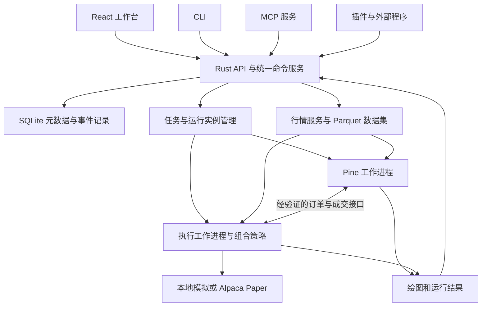

# tradingdashboard 开源交易系统调研与实施计划

日期：2026-10-13。范围：架构调研、源码复核、可复现的离线探针、实施与验收计划。

实施更新：本页的源码问题和探针结果记录原始提交 `c8103809fe7b18d88cba9747518f4872d12aa3c1` 的基线。后续已实现 Pine 原生回测接入、独立 Worker、命名参数兼容补丁、基础图形、CLI 和历史账本回放；运行方法与边界见 [README](../README.md)，固定公开语料的最新执行结果见 [测试报告](research/pine-public-execution.json)。Rust 服务、持续模拟及券商接口仍按下述计划推进。

建议将现有 React 工作台发展为可自托管的交易系统：Rust 负责应用服务和开放接口，Pine 使用独立运行时，组合策略采用目标仓位模型，回测与模拟执行采用明确的执行契约。优先复用成熟组件，把开发投入放在数据、策略语义、账户状态和扩展接口的连接处。

本计划采用用户已确认的要求：美股与 ETF 优先；Pine 尽量直接兼容从 TradingView 复制的复杂源码；本地和服务器均可自托管；提供 MCP、CLI、API、插件扩展；不内置 AI 聊天、模型配置或提示词交互。已有 `plans/trading-workbench-099c6cb3.md` 仍记录前端阶段的历史范围，本计划提出后续完整系统的范围。

## 1 产品参照与取舍

| 参照 | 核实的能力与可借鉴内容 | 本项目的取舍 |
|---|---|---|
| TradingView | 看盘、脚本编辑、绘图、策略报告；其图表库不提供 Pine 引擎 | 借鉴图表与编辑体验，独立解决脚本执行和数据供给。不能通过购买或嵌入图表库自动获得 Pine 兼容性。[官方 FAQ](https://www.tradingview.com/charting-library-docs/latest/getting_started/Frequently-Asked-Questions/) |
| Composer Trading | 资产、权重、条件、过滤、分组构成嵌套组合；支持按日历或权重偏移再平衡 | 实现多资产分配树和逐期持仓解释。现有“入场/出场条件”编辑器只覆盖其中一类策略。[编辑器](https://help.composer.trade/article/54-create-tutorial)、[权重](https://help.composer.trade/article/18-symphony-editor-assign-weights)、[阈值再平衡](https://help.composer.trade/article/76-threshold-trading) |
| Composer 回测 | 官方区分历史复权收盘数据和实际交易窗口的报价 | 参考其假设披露方式；本系统自行规定信号时点、成交时点、分红和成本，不把跨平台收益相同作为默认前提。[回测说明](https://help.composer.trade/article/67-backtest-basics) |
| QuantConnect / LEAN | 模块化事件驱动引擎、可替换模型、本地 CLI 工作流 | 借鉴研究—回测—运行的产物组织和插件点。LEAN 作为引擎备选，不与 Nautilus 同时成为首版必装引擎。[仓库](https://github.com/QuantConnect/Lean) |
| OpenBB | 数据平台和提供商扩展 | 借鉴标准化数据与提供商接口；作为可选数据插件，订单和账户执行由本系统管理。[仓库](https://github.com/openbq-org/OpenBB) |
| 本地 Open Composer | 策略版本、按收盘时间计算、目标仓位、订单回执、部分成交、恢复与核对 | 选择性移植契约、测试案例和适配器经验。独立部署，不依赖旧项目目录、定时任务或运行账户。 |

Composer 分配树需要输出整个组合的目标权重；Pine `strategy()` 通常围绕图表标的及自身账户状态运行。这两类策略共享账户、数据、事件和运行管理，但保留各自的源表达形式。

## 2 现有代码复核

### 2.1 tradingdashboard

基线提交：`c8103809fe7b18d88cba9747518f4872d12aa3c1`。本轮仅新增调研文件和探针，未修改应用实现。

| 现状 | 实现时的处理 |
|---|---|
| React、Dockview、CodeMirror、图表和工作区已有实现 | 保留外壳与交互，逐个面板接入服务端契约 |
| `src/data/feed.ts` 使用生成行情，并持续更新最后一根 bar | 换为市场数据服务，真正形成新 bar，区分形成中与已收盘数据 |
| Pine 包已安装 0.11.1，但 `src/pine/runtime.ts:76` 以正则封锁多个 API | 改为运行时能力检查、具体诊断和版本化兼容矩阵 |
| Pine 成交记录被提取成信号，再送入第二个回测器 | 删除这种二次撮合路径；每次运行只有一个成交权威 |
| Pine 图表实时更新不等同于内置指标更新；当前缓存不包含每次行情变化 | 接入同版本的持续运行实例、数据修订与增量输出协议 |
| Paper 策略执行只开多，未完整保留风险配置 | 用策略包、订单意图、执行回报和真实账户状态替代布尔开平仓逻辑 |
| 权限开关仅在页面状态，MCP/CLI/REST 主要是接口展示 | 服务端强制权限与参数检查；各入口调用同一命令处理器 |
| 账户和策略主要保存在 localStorage | localStorage 只保留 UI 缓存；服务端管理版本、运行与账本 |

可复现证据：[探针程序](research/pine-probes-2026-10-13.cjs)、[结果 JSON](research/pine-probes-2026-10-13.json)。运行命令：

```bash
node plans/research/pine-probes-2026-10-13.cjs
```

PineTS 原始运行时通过了数组、map、matrix、UDT、table、while 六个合成样例的数值检查；项目封装拦截 map、matrix、UDT、table。table 成功执行不代表 UI 已能绘制表格。探针不是 TradingView 对照测试，也未验证复杂脚本、多周期、实时回滚或券商执行。

时序探针在 bar 索引 1 发出开仓指令，PineTS 返回索引 2 的成交；现有回测器又在索引 3 成交。平仓同样从索引 5 变成 6。这个问题会同时改变价格、盈亏和交易标记。

### 2.2 本地 Open Composer

主要参考目录是 `/root/codex-test/open-composer`；`/root/open-composer` 是旧副本，不用于判断当前能力。

值得复用的接口与实现：

- `open_composer/execution/bar_source.py`：按 `bar_close_ts <= as_of` 约束可见行情。
- `open_composer/execution/signal_engine.py`：`compute(bars, spec, state, as_of)` 输出目标权重、信号、新状态。
- `open_composer/intraday_runner/engine.py`：信号、意图、净订单、提交结果、成交同步依次记录；重启后按订单标识核对。
- `open_composer/book_paper/post_close.py`：订单、成交、持仓核对，以及交易成本和每日收益记录。
- `open_composer/strategy_versions.py`：策略版本和内容绑定。
- `tests/test_backtest_reference_parity.py`：六个确定性参考场景；上一轮本地执行为 6 passed。

复用限制：本地 NautilusTrader 为 1.219.0；多标的路径仍有 Python 回退，Nautilus Paper 计划明确没有启动 Nautilus live strategy node。参考回测与日内 runner 的止损判断周期也不同。应复用测试和设计依据，再验证新系统的行为，不能认定旧系统已提供完全统一的引擎。

## 3 开源组件选择

许可证描述来自当前仓库或已安装包；实施时锁定具体版本并随发行包保存对应 LICENSE/NOTICE。

| 模块 | 建议 | 理由、约束与替代 |
|---|---|---|
| 前端 | React + TypeScript + Vite | 沿用现有代码；Zustand 管 UI 状态，服务端数据不再以浏览器状态为唯一依据 |
| 工作区 | Dockview，MIT | 现有项目已使用；停靠、分组、标签和布局存档继续复用。[仓库](https://github.com/dockview/dockview) |
| 图表 | P0 优先验证 Vela + Vela-PineTS；Lightweight Charts 保留为基线 | Vela 提供绘图、脚本接口和渲染插件，可减少复杂 Pine 输出的自建工作。P0 对同一脚本集比较绘图完整性、联动、内存、刷新和布局适配，通过后再替换 ChartCanvas。Vela 为 Apache-2.0，Pine 插件为 AGPL-3.0，均有独立发行约束。[Vela](https://github.com/LuxAlgo/Vela)、[插件](https://github.com/LuxAlgo/Vela-pinets) |
| 图表基线 | Lightweight Charts，Apache-2.0 | 当前可用；复杂表格、对象和交互需补渲染层。发行时提供要求的归属说明。[仓库](https://github.com/tradingview/lightweight-charts) |
| 编辑器 | CodeMirror 6，MIT | 复用；新增编译诊断、源码位置、依赖管理和设置绑定，避免用正则修改输入参数 |
| 组合构建 | 先用已有 React 组件实现嵌套分配树 | React Flow（MIT）可做后续图视图，节点编辑库并不提供分配与交易语义。[React Flow](https://github.com/xyflow/xyflow) |
| Rust 服务 | Axum + Tokio + Serde | 承担 API、任务、事件订阅、配置、插件协调和权限；CPU 密集计算放在工作进程。[Axum](https://docs.rs/axum/latest/axum/) |
| Pine 运行 | PineTS 0.11.1 为第一候选 | 已在仓库可运行，Node 与浏览器可共享版本；AGPL-3.0-only/商业双许可。复杂兼容性须以固定脚本集实测。[仓库](https://github.com/LuxAlgo/PineTS)、[覆盖表](https://docs.luxalgo.com/developers/pinets/api-coverage) |
| 组合回测与执行 | NautilusTrader 工作进程 | 提供事件驱动的行情、订单与账户模型；LGPL-3.0-or-later。版本取舍见下文，不直接绑定开发分支。[仓库](https://github.com/nautechsystems/nautilus_trader) |
| 事务存储 | SQLite + SQLx | 首版单实例可自托管，服务端单写入口；持久化命令、运行、订单事件和投影。多人高并发或多实例阶段再引入 PostgreSQL。[SQLx](https://github.com/transact-rs/sqlx) |
| 大规模行情与分析 | Parquet / Arrow + Polars | 列式文件存行情与结果，元数据存数据库；DuckDB 可作为研究查询插件，首版不强制同时引入两个查询引擎。[Polars](https://github.com/pola-rs/polars)、[DuckDB](https://github.com/duckdb/duckdb) |
| MCP | 官方 Rust SDK `rmcp` | 提供本地 stdio 和远程 Streamable HTTP，声明并测试协议版本兼容。[SDK](https://github.com/modelcontextprotocol/rust-sdk)、[传输规范](https://modelcontextprotocol.io/specification/latest/basic/transports) |
| 首个真实行情与券商模拟 | Alpaca 数据 + Alpaca Paper 适配器 | 美股/ETF 接入清晰；各自托管实例使用自己的凭据。数据 entitlement、交易时段和订单能力显式报告。[数据](https://docs.alpaca.markets/us/docs/about-market-data-api)、[Paper](https://docs.alpaca.markets/us/docs/paper-trading) |
| 外部研究能力 | OpenBB、独立 Python 研究插件 | 可选安装；不将其依赖树纳入所有用户的基础启动链 |
| 后续加密货币 | 优先已有执行引擎的 venue adapter，必要时接 CCXT | 第二阶段扩市场；Freqtrade 可借鉴运行管理和回测差异检查，不作为美股系统核心。[CCXT](https://github.com/ccxt/ccxt)、[Freqtrade](https://github.com/freqtrade/freqtrade) |
| 后续计算插件沙箱 | Wasmtime | 适合受限纯计算插件；首版先稳定进程协议和 SDK，避免同时建设 WASM 平台。[仓库](https://github.com/bytecodealliance/wasmtime) |

### 3.1 Nautilus 版本与接入复核

截至调研日，PyPI 默认包为 1.231.0；GitHub 已发布 2.0.0rc6。1.231.0 的发布说明明确说明 1.x 到 Rust/PyO3 v2 的迁移，并列出接口和存储变化。因此，最新文档的 Rust 全栈能力不能直接套到本地 1.219.0。[1.231.0 发布说明](https://github.com/nautechsystems/nautilus_trader/releases/tag/v1.231.0)、[发布列表](https://github.com/nautechsystems/nautilus_trader/releases)

P0 在隔离环境比较 1.231.0 与当时固定的 v2 候选版本：单标的、多标的目标权重、订单生命周期、恢复、费用和内存。优先采用通过合同测试且具备后续维护路线的版本。1.231.0 可用作短期验证基线，不能不加评估地将即将退出主要维护的分支当作长期基础。

对外固定 `ExecutionWorker` 协议，内部可以先用 Python SDK 驱动其核心；Rust 控制服务不受 Python SDK 形状约束。v2 通过验收后可更换 Rust 实现的工作进程。

官方当前集成列表包含 IBKR、Databento 等，未列出 Alpaca。**Alpaca connector 必须作为需要实现并测试的工作包**，不能写成“安装 Nautilus 即可接通 Alpaca”。本地旧适配器提供参考，但尚不是现成的 Nautilus Alpaca execution client。[集成列表](https://nautilustrader.io/docs/latest/integrations/)

### 3.2 Pine 候选评审

| 候选 | 可用价值 | 决策 |
|---|---|---|
| PineTS | v5/v6 源码执行、图形输出、策略 namespace、实时与多周期能力；本地探针已有基础证据 | 第一候选。锁版本、补适配层、维护小范围上游补丁；不把 README 的兼容口号当验收结果 |
| PineForge | C++ 引擎及 C ABI，包含 Pine 语义适配与对照工具 | 引擎 Apache-2.0，但 Pine 编译器是独立的 source-available 许可，商业使用需要相应许可。可研究其测试方法、作为可选用户自配后端，不能把整条 Pine 链默认当成宽松开源组件。[引擎](https://github.com/pineforge-4pass/pineforge-engine)、[编译器](https://github.com/pineforge-4pass/pineforge-codegen-oss) |
| PyneCore | Apache-2.0 的 Python 运行框架 | 官网的现成 Pine 转换路径使用独立 pynesys.io 服务和 API key；自托管运行时不等于自托管编译器。保留为可选适配器，不作为默认离线编译路径。[官网](https://pynecore.org/) |
| Pinecone | Rust 解释器及 LSP，MPL-2.0 | 文档声明 v4/v5，尚不能据此满足复杂 v6 兼容要求。适合后续研究原生 Rust 和编辑器能力，首版不以此承担关键路径。[仓库](https://github.com/ferranbt/pinecone) |
| TradingView 图表库 | 图表能力 | 官方明确不支持 Pine；排除作为脚本引擎的方案 |

PineTS 的官方语言覆盖页与本地包实测并非完全同步，例如网页仍写部分循环未实现，而本地 while 小样例通过。以锁定版本的源码和测试为实施依据，同时保留未验证清单。[语言覆盖页](https://docs.luxalgo.com/developers/pinets/lang-coverage)

默认开源发行建议评估 AGPL-3.0 方案，以适配 PineTS 的实际依赖；若希望允许闭源集成，须另行确定相容的运行时与许可路径。独立进程、可选插件或 API 边界本身不能作为免除许可证义务的结论。SDK、宿主和第三方插件的授权关系在 P0 写清，本计划不擅自修改仓库 LICENSE。PineForge 的基准成绩是作者报告，未在本轮独立重现。

## 4 目标架构



这是模块化服务加工作进程的结构。首版采用一个 Rust 应用服务、按需运行的 Pine/执行工作进程和本地持久化；不依赖 Kubernetes、Kafka 或独立 Redis 才能启动。React 静态文件可由 Rust 服务提供。大量历史数据通过分片文件或批量流交给 worker，禁止每根历史 bar 在数个进程间往返一次 RPC。

### 4.1 策略包与运行合同

统一的是策略包外壳和运行合同，源码按类型保留：

```text
StrategyPackage
  id, version, source_hash, schema_version
  kind: pine | allocation_tree | native_plugin
  source + input_schema + dependencies.lock
  universe + timeframe + calendar + data_requirements
  supported_execution_profiles + capabilities

RunManifest
  strategy_version + runtime_id + runtime_version
  data_snapshot + input_values + session + adjustment
  execution_profile + account_model + cost_model
  random_seed_if_used + warmup + evaluation_window
```

Pine 的源文件是该策略的来源；Composer 风格策略的来源是结构化分配树；原生策略来源是插件和其配置。完整 Pine 不强制转换成积木，也不承诺任意多资产分配树可以导出为等价 Pine 策略。单标的且经过验证的子集可提供 Pine 导出。

每个结果关联策略、数据、运行时、执行规则与依赖版本。更新策略产生新版本；已部署的实例继续绑定原版本，升级是独立可追踪动作。

### 4.2 账户与事件

统一事件包括 `Signal`、`TargetPortfolio`、`OrderIntent`、`OrderAccepted`、`OrderRejected`、`OrderCancelled`、`Fill`、`PositionSnapshot`、`AccountSnapshot`、`RunStatus`。事件带运行、策略、账户、标的、关联订单、时间和递增序号。

每个账户运行实例只有一个持仓与成交状态权威。Rust 保存事件和可重建的查询投影；浏览器只显示投影。实际订单成交以后才更新已成交持仓；待成交数量单独记账。

命令以幂等键写入持久化记录。券商提交前记录订单意图和确定性 `client_order_id`；超时后先查询，再决定是否重试。目标是可恢复、可核对的执行，不承诺网络条件下的抽象“绝对只执行一次”。

## 5 Pine 是首要实现风险

### 5.1 分开验证六种能力

对每个脚本分别报告：解析、指标计算、绘图、历史回测、持续模拟、券商模拟执行。成功解析不能代表其余五项通过。

P0 固定第一批 50 个有合法可用源码的代表脚本和至少 50 个语义用例。代表脚本覆盖用户日常使用类型，不能只挑已知通过的例子。每个失败归因于语言、数据、渲染、执行或缺失依赖；修复后整个固定集重跑。用户的具体脚本可随后加入，不阻塞先建立公开样本与自写语义用例。

重点覆盖：

- `var` / `varip`、历史索引、`na`、循环、函数、方法、UDT、数组/map/matrix。
- `request.security`、低周期请求、跨标的、会话、时区、预热和数据可见时间。
- plot、fill、背景、标签、线、box、table 与多窗格；对象更新和删除。
- entry/order/exit/close/cancel、做多/做空/反转、加仓、部分退出、限价/止损、OCA、trailing。
- `process_orders_on_close`、`calc_on_order_fills`、`calc_on_every_tick`、实时 rollback。
- 本地库依赖和 `import`。不能访问源码的受保护脚本不在可直接导入范围；缺失源码/许可/版本的依赖必须明确指出。

使用相同 OHLCV、会话、复权、输入和执行设置，对照用户有权导出的 TradingView 图形数值和交易列表。数值容差按字段制定；订单方向、数量、成交 bar 和触发顺序要求语义一致。自写确定性案例提供无需外部账户的基础 oracle。缺少 TradingView 对照的样本标记为“本地验证”，不能改称“TradingView 等价”。

v5/v6 是优先目标，旧版本根据实际脚本需求添加。语义验收依据[执行模型](https://www.tradingview.com/pine-script-docs/language/execution-model/)和[策略文档](https://www.tradingview.com/pine-script-docs/concepts/strategies/)，不会将网页上“所有 API 已实现”直接转换成兼容性承诺。

### 5.2 两个执行配置，禁止二次撮合

**Pine 兼容运行**：Pine 运行时管理其虚拟订单、持仓和 `strategy.*` 状态。图表、历史回测、bar replay、实时数据下的本地持续模拟直接消费该运行时的交易事件和账本；统一报告层只计算展示统计，不把已发生的成交变成信号送去再次撮合。

**券商执行运行**：只有经过验证的 Pine Order Host 才能部署。Pine 发出原始订单意图；执行系统/券商回报成为 `strategy.position_size`、权益、开放交易和成交回调的输入。关闭同一实例内部的虚拟撮合。该配置自身也必须可在历史模拟中运行，用于比较同配置的历史与持续行为。

这需要订单发出、撤改、成交反馈、部分成交、账户读写、状态快照等扩展点。已检查的 PineTS 公共类型主要暴露 run、stream、context，没有足够依据认定成熟的外部 Broker Host 已开箱可用。**这是一项 P0 技术验证和可能的上游补丁工作，不是普通 API 胶水代码。**

如果扩展点不能通过状态反馈测试，允许提前交付 Pine 看盘、回测和本地持续模拟，但整体产品不得宣称“复杂 Pine 已完整部署到 Alpaca”。进入修复/运行时替换分支，保持该里程碑未完成。

两个执行配置的成交模型和结果可不同，UI 显示配置与差异。不得自动切换运行时、强行统一收益，或在实时运行中读取整段回测的最后一笔交易下单。

### 5.3 数据与进程约束

行情必须带标的元数据、最小价格变动、交易所时区、真实会话收盘时间。当前 `bar.time + 固定秒数` 的做法不能代表美股每日及提前收盘日。

Pine worker 使用宿主提供的数据源和锁定依赖；浏览器预览与服务器正式运行绑定同版本。高周期可见性、形成中 bar 更新和收盘确认分别处理。脚本超时、循环限制、内存限制、错误定位和工作进程终止必须可用；Web Worker 只解决 UI 阻塞，不能代替服务器隔离。

快照恢复若无法完整保存运行时对象，先用固定版本历史数据重新预热，再从持久化检查点接回实时事件；预热阶段禁止提交旧订单。快照和重放方案由一致性测试选择，不直接序列化 JS 闭包。

## 6 Composer 风格组合策略

首版节点：资产、现金、分组、等权、指定权重、逆波动率、条件分支、排名筛选、按日历/偏离阈值再平衡。市值权重待历史基本面和点时数据可靠后加入。

例子：SPY 处于趋势条件时，在若干 ETF 中按过去收益排名选择两个并等权；否则配置 BIL；按周再平衡。编辑器应能解释“本次选择哪些资产、为何选择、目标权重多少、与当前持仓相差多少”。

分配树输出 `TargetPortfolio`，经过资金、暴露、交易资格和可成交数量检查后生成订单差额。首版每个策略先有明确资金分区；共享账户的多个策略保留独立账本，再净额提交。实际成交按照预先声明的规则分配回各策略。

固定规则：稳定的并列排名、重复资产权重合并、空筛选结果处理、缺数据处理、最低交易额、碎股或整数股模式、交易日历、波动率预热与分红口径。缺数据默认暂停该决策并说明原因；现金回退是明确的策略配置，不能悄悄发生。

使用同一分配计算模块和风险规则驱动历史回测与持续模拟，变化的是时钟、行情来源和成交适配器。资产多、界面节点多不等于已经完成组合执行。

## 7 数据与模拟交易

数据源先交付离线 CSV/Parquet 和 Alpaca HTTP/WebSocket。每个数据集记录 provider、feed、symbol identity、时区、会话、复权方式、缺口、修订版本和时间范围；跨周期聚合从同一底层数据与日历产生。断流显示延迟/断开，不切换为演示价格。

Alpaca 免费基础数据并非全市场 SIP；Paper Only 用户的行情 entitlement 与模拟成交所用报价也可能不同。完整系统要求显示 feed，避免拿不同数据源的收益差异误判为引擎错误。授权数据不默认随开源仓库再分发。[数据说明](https://docs.alpaca.markets/us/docs/about-market-data-api)、[Paper 说明](https://docs.alpaca.markets/us/docs/paper-trading)

股息、拆股和复权必须选择一致的会计模型：不能同时使用总回报调整价并再次将同一股息加入收益。报价/成交价与研究调整价格有各自用途。首版演示资料附数据许可或明确标为合成数据；真实账户使用用户自己的行情权限。

| 模式 | 用途 | 必须满足 |
|---|---|---|
| Demo | 新安装立即体验 | 明确合成数据；完整功能链可操作 |
| Historical backtest | 历史研究 | 数据快照、预热、成本、成交模型和版本固定 |
| Replay | 加速回放 | 按事件时钟推进；相同输入下可重现 |
| Local paper / shadow | 实时数据下本地模拟 | 服务器持续运行；关闭网页不影响；和所选 profile 的历史规则一致 |
| Broker paper | Alpaca 模拟账户 | 订单、拒单、部分成交、撤单、账户与持仓核对真实接通 |
| Live | 后续扩展 | 首版只保留能力接口，不作为本次交付的必要券商通道 |

Paper 账户不是实盘收益的等价实验。费用、交易冲击、分红等模拟限制记录在结果中；这不会阻止功能闭环验收，也不能被隐藏。[官方限制](https://docs.alpaca.markets/us/docs/paper-trading)

## 8 MCP CLI API 与插件

### 8.1 一份命令定义，多种入口

UI、CLI、REST、MCP 都调用 Rust 命令服务。共同执行参数验证、权限、幂等、任务创建和事件记录；禁止某个入口直接更改另一套浏览器账户。

首版命令族：

```text
system.health / system.capabilities
data.search / data.import / data.fetch / data.snapshot
strategy.validate / strategy.createVersion / strategy.diff
pine.check / pine.run / pine.compatibility
backtest.start / backtest.status / backtest.cancel / backtest.results
paper.deploy / paper.pause / paper.stop / paper.positions
orders.preview / orders.submit / orders.cancel / orders.reconcile
plugins.list / plugins.validate / plugins.enable / plugins.disable
workspace.export / workspace.import
```

长任务立即返回 `job_id`，支持状态、取消、结果路径和事件 cursor。客户端断开不等于取消服务端任务。CLI 默认有人类可读输出，`--json` 提供稳定机器格式与退出码。

MCP 提供工具和只读资源：策略版本、能力、运行状态、报告、图表数据及账户快照。本地用 stdio，服务器用认证的 Streamable HTTP；stdout 保留协议流，日志写 stderr。首版测试至少两种实际客户端，固定支持的协议版本范围。[SDK](https://github.com/modelcontextprotocol/rust-sdk)

权限最少区分读取、策略写入、运行回测、管理本地模拟、券商模拟下单和插件管理。它们是服务端能力；撤销之后现有连接同样受约束。API/OpenAPI、JSON Schema、错误码和能力描述随版本发布。MCP 是对外控制入口，不承担内部高频行情传输，也不需要内置 AI 聊天才能使用。

### 8.2 第一版插件合同

插件点包括行情、指标/计算、策略运行时、回测后端、券商、报表和 UI 面板。首版给出三个真实示例：CSV 数据插件、自定义指标、独立报告面板；插件安装、升级、停用和卸载均通过同一宿主合同。

manifest 字段：`id`、`version`、`api_version`、`entrypoint`、`contributes`、`permissions`、配置 schema 和迁移版本。宿主声明可用能力，插件声明需求；不支持的版本在加载前拒绝并给出原因。

后台扩展默认以独立进程/容器运行，使用版本化 JSON-RPC 控制协议和批量数据引用，支持 Rust、Python、TypeScript 等语言；无需插件作者采用 Rust ABI。进程本身不等于沙箱：默认不给券商密钥，网络、文件与资源能力由宿主配置约束。

前端第一方 React 扩展可使用宿主 SDK；第三方面板默认采用隔离 origin 的 iframe 与受限消息桥。首版不提供任意远程 JS 注入页面，也不将“动态加载成功”视为插件权限已生效。

公开 SDK 应提供类型、样例、开发启动器、mock host、合同测试、版本兼容说明，以及一个独立仓库插件接入验收。Wasmtime、插件市场和自动更新留待实际扩展需求明确后建设。

## 9 部署与维护

首版发布固定版本的容器、开发者源码启动方式、示例配置、数据导入器和诊断 CLI。目标入口是 `docker compose up`；UI 由 Rust 服务提供，worker 仅在内部网络访问。

默认单用户实例、一个元数据库和可挂载的数据目录。首次启动生成本实例认证信息；远程访问采用 HTTPS 和服务端认证。secret 存宿主受控配置，不进入图表包、浏览器 localStorage、运行报告或插件默认环境。

验证首次安装、重启、崩溃恢复、备份恢复和数据库升级。客户端重连先获取快照再补事件，不能把重连当成重新下单。生产使用的 JS/Python 包、Rust crate 和镜像都锁版本。

目标资源基线在 P0 测量：4 图工作区、20 个订阅标的、2 个持续策略、1 个回测任务。给出硬件、数据条数、峰值内存和耗时，不预先宣称 60fps 或固定吞吐。研究批量回测不能饿死正在运行的模拟账户；两类任务使用独立并发预算。

## 10 架构 Review 与裁定

| 需要质疑的方案 | 复核结果 | 裁定 |
|---|---|---|
| 为满足 Rust 技术栈立即重写 Pine 与全部交易引擎 | 复杂 Pine 是兼容工程；现有 Rust 解释器的目标版本不足以直接替代 | Rust 做系统服务，运行时可插拔；先取得兼容和执行证据 |
| 所有策略统一降级成 long/short/flat 信号 | 丢失价格、订单 ID、数量、撤改、部分退出及账户反馈 | 保留 Pine 订单语义和组合目标权重两种策略合同 |
| Pine 回测生成成交，再由 Nautilus 撮合一次 | 当前项目已复现额外延迟 | 每次运行明确单一成交权威；报告只导入，不重撮合 |
| 从完整历史回测抽取最后信号驱动 Paper | 对未来可见性、运行状态和幂等没有正确保证 | 使用持续运行状态和逐事件反馈 |
| 安装 Nautilus 后 Alpaca 立即可用 | 官方集成清单没有该适配器；本地是独立实现 | 计入数据与 execution client 的开发和合同测试 |
| 最新文档等于已安装版本功能 | 本地 1.219、PyPI 1.231、v2 RC 存在明显差异 | 隔离版本比较，锁定通过测试的实现 |
| 使用“开源 Pine 引擎”就得到完整自由编译链 | PineForge 引擎/编译器、PyneCore 运行时/转换服务的许可与部署边界不同 | 默认路径须源码、构建、编译、运行都可满足所选开放许可 |
| 任意 Composer 树和 Pine 可双向无损转换 | 多资产组合与图表策略的执行模型不同 | 只对经过定义的子集导出；保留各自源码 |
| 本地回放通过就等于真实券商模拟通过 | 实际拒单、部分成交、断线恢复仍需验证 | 离线验收与联网验收分别计分，整体发布需完成目标联网链路 |
| 插件 manifest 写了权限就已实现隔离 | 当前页面开关未进入执行路径 | 用未授权调用、卸载与资源超限测试验证宿主行为 |
| 给各面板接几条 API 就完成产品 | 任务、数据、运行、账户和事件必须有一致来源 | 按完整用户路径交付，避免长期存在真假并行的功能按钮 |

## 11 实施工作包与验收

下表保留完整阶段目标。上述 Pine 切片已落实部分 P0／P3 内容，整阶段仍须通过各自验收。依赖关系控制顺序，可并行的 UI 和服务开发通过固定合同协作。

| 阶段 | 交付内容 | 完成证据 |
|---|---|---|
| P0 可行性与锁定 | Pine 固定脚本集；Vela/LWC 对照；Pine Order Host 最小实验；Nautilus 版本对照；许可证与发行边界 | 逐脚本报告；一段包含状态反馈的策略在历史/持续模式下逐事件一致；选型记录和未解决项。若关键项失败，更新方案，不能以删掉复杂 Pine 要求通过 |
| P1 系统底座 | Rust 服务、策略包与版本、SQLite 迁移、任务、事件、React client、CLI、Compose | 新机器启动；创建版本→启动任务→观察事件→重启→查询结果；认证与幂等真实有效 |
| P2 行情与看盘 | CSV/Parquet、Alpaca 数据、日历/复权/聚合、四图联动、Pine 指标与绘图 | 图表和后端使用同一数据快照；断流、恢复、形成新 bar 正确；复杂指标在服务器与浏览器同版本运行 |
| P3 Pine 完整本地运行 | 原生 Pine 回测、报告、bar replay、本地持续模拟、依赖包管理 | 通过代表脚本和语义集；图、交易、权益相符；反转、部分退出、重算、重启不重复成交 |
| P4 Composer 组合闭环 | 分配树、筛选、权重、日历/阈值再平衡、成本、组合报告、本地模拟 | 至少三种组合从编辑到运行完整通过；逐期持仓可解释；历史与持续回放生成相同目标/订单 |
| P5 Alpaca Paper | execution client、订单状态机、提交核对、账户同步、资金分区、Pine 反馈桥 | 在用户配置的独立 Paper 账户完成下单→成交→持仓→撤单/平仓→重启核对；Pine 与 Composer 各有完整案例；并有离线故障注入覆盖真实难以稳定触发的拒单/部分成交等场景 |
| P6 开放与发行 | MCP、API 文档、TS/Python SDK、插件 SDK 与样例、打包、升级、备份 | 外部 MCP 客户端和 CLI 都走通同一流程；独立插件仓库无需改宿主即可接入；从空目录按文档部署成功 |

P1 同时定义 CLI/MCP 的命令 schema，P6 完成客户端互操作和发行；不能到最后才发现控制接口无法表达关键操作。

建议第一批实施任务按以下顺序拆分：

1. 将当前 Pine 二次撮合样例变成回归基线，保存现状和预期。
2. 创建独立 Pine worker 原型，支持源码、输入、离线数据和完整输出。
3. 跑固定 Pine 脚本集，验证图形适配和订单/账户反馈扩展点。
4. 用相同脚本和数据比较 Vela 与现有图表实现。
5. 用两个 ETF 的目标权重策略验证固定版本 Nautilus 的历史、sandbox 和恢复合同。
6. 定义 StrategyPackage、RunManifest、事件和 worker 协议。
7. 建立 Rust 服务、持久化、任务与 CLI 最小切片。
8. 接入真实行情后扩展交互，再完成两个策略种类的券商模拟闭环。

P0 后才给可靠日历排期：工作量主要取决于 Pine 订单状态接口、库导入支持、图形输出以及 Nautilus 版本迁移结果。并行堆叠 UI、引擎重写和多券商接入会扩大集成风险。

## 12 完全跑通的发布标准

下面全部是验收条件，不是本轮已完成的功能。

1. 干净机器按文档启动，示例无需行情密钥；联网链路可填写自己的凭据。
2. 从搜索美股/ETF、加载行情、多图联动，到 Pine 复杂指标显示，数据来源可追踪。
3. 原样导入固定集中的 Pine 策略，设置输入，完成回测、交易标记、结果导出和连续模拟。
4. Composer 分配树完成多资产回测、逐期持仓解释、再平衡和持续模拟。
5. Pine 与 Composer 各至少一个已认证策略完成 Alpaca Paper 完整订单链。
6. 同一策略版本、数据和执行配置，批量回测与事件回放给出一致订单/持仓/权益；券商成交差异有独立可查记录。
7. 进程重启、UI 关闭、重复命令、订单提交超时不会导致重复下单或丢失账户状态。
8. 日历切换、提前收盘、DST、缺行情、拆股和股息采用声明的处理方式，并有针对性用例。
9. MCP、CLI、Web 对同一命令返回关联到同一运行的结果；外部客户端能列能力、创建版本、启动/取消任务、读取报告和管理获授权的模拟运行。
10. 第三方能按公开协议提供一个数据插件和一个界面/报告插件，完成加载、授权、升级与卸载。
11. 数据库和行情目录可备份、恢复、迁移；发行版包含必要的许可、归属说明与明确的兼容矩阵。
12. 不支持的脚本能力或订单能力显式阻止依赖操作，不能静默省略后仍显示成功。

本轮完成的是调研、review、六个离线 Pine 特性探针及二次撮合复现。尚未完成 TradingView 大样本对照、Vela 浏览器对照、Pine 外部成交反馈桥、Nautilus 版本迁移或任何券商下单。后续实现以这些发布条件验收，而不是以页面数量或构建通过验收。
